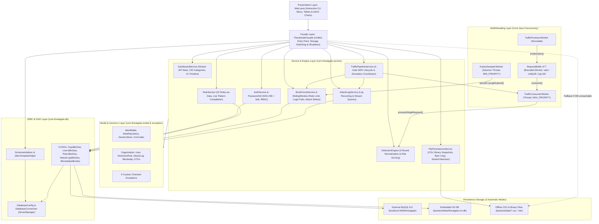
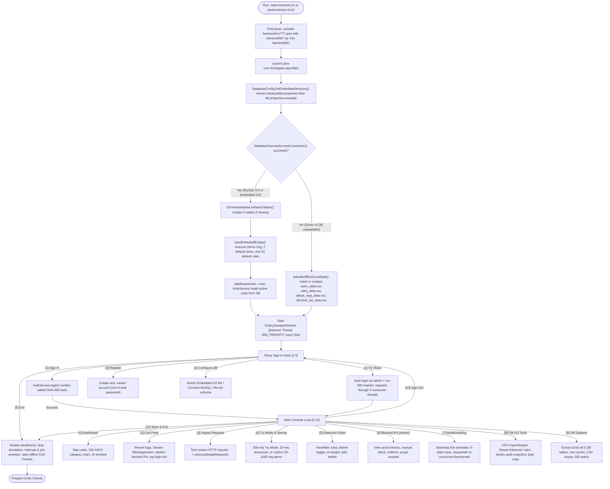
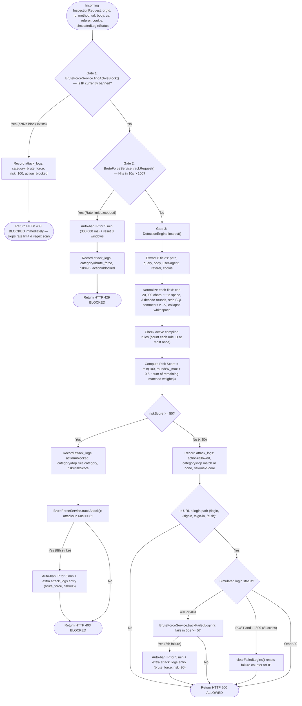
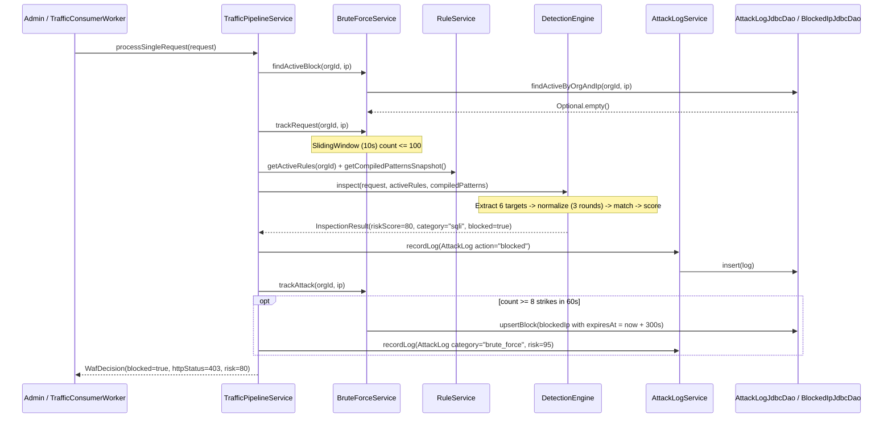
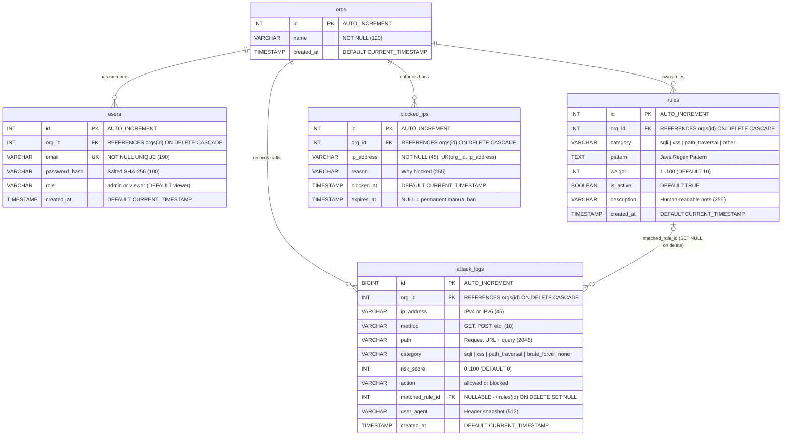
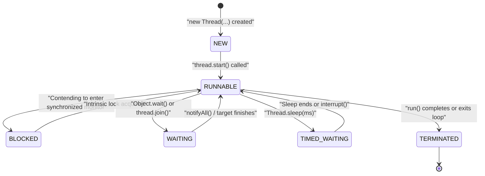
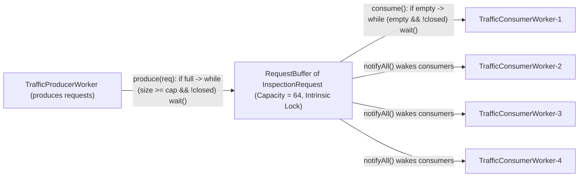
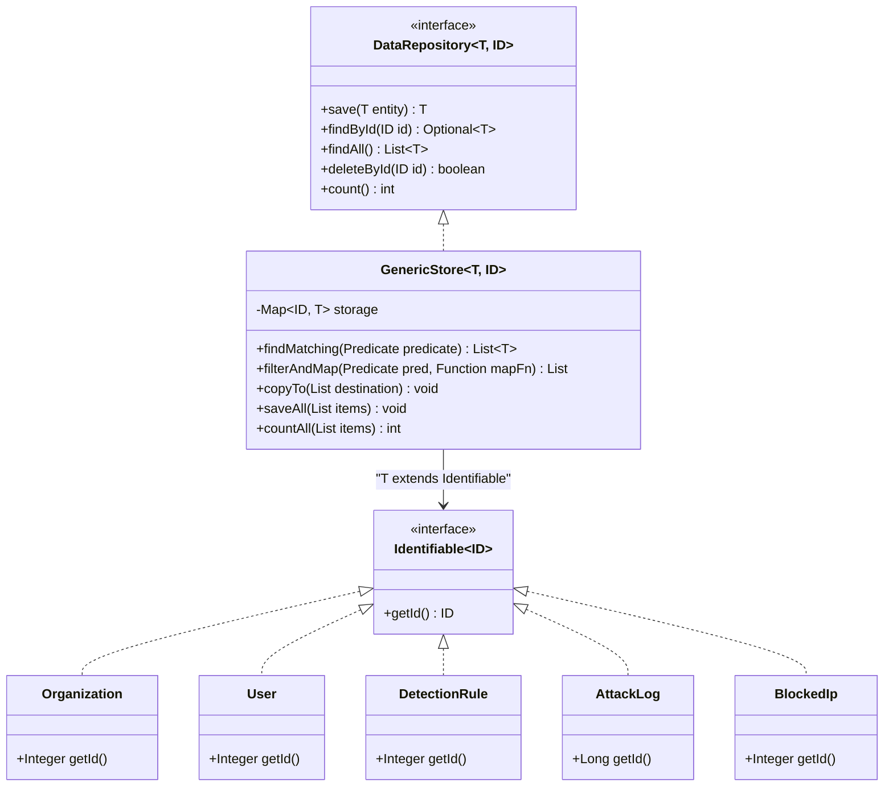

# ThreatGate — Complete Project Guide, Flowcharts, ER Diagram & Java Viva Notes

> **What this file is:** A complete, plain-English walkthrough of the entire **ThreatGate** project designed for quick revision and oral **viva** preparation. It explains what ThreatGate does, how every request flows through the system, every database table, all **51 Java files**, every **Java syllabus topic (Lectures 9–30)**, **500-request Try Mode**, the **61 automated test assertions**, and ready-to-speak **Viva Q&As**.

---

## 1. Project Overview & 60-Second Viva Summary

**ThreatGate** is a **Reverse-Proxy Web Application Firewall (WAF)** built as a **pure Core Java CLI backend** (`com.threatgate`) paired with a shared SQL schema (`schema/schema.sql`) and an untouched React/Vite UI (`frontend/`).

Think of a WAF like a **security checkpoint** standing in front of a web application:

- Every incoming HTTP request (`method`, `url`, `body`, `User-Agent`, `Referer`, `Cookie`, and client `IP`) passes through ThreatGate **before** reaching the real application.
- ThreatGate checks whether the IP is already blocked, checks rate limits, decodes sneaky obfuscated inputs, scans the request against **22 regex-based detection rules** ("rules-as-data"), calculates a **0–100 risk score**, and decides whether the request is **`allowed` (HTTP 200)** or **`blocked` (HTTP 403 / 429)**.
- Repeated failed logins (`401`/`403`), flooding (rate limit), or repeated attack strikes automatically ban the attacker's IP for **5 minutes**.
- Every decision is logged into a relational database (**External MySQL 8.0** or **zero-server Embedded H2**, with automatic **Offline CSV Fallback** if no DB is reachable) and can be analyzed through an interactive CLI dashboard, Stream API filters, multithreaded traffic simulators, File I/O tools, and a built-in Database Explorer.

### Quick Facts at a Glance

| Item | Details |
| :--- | :--- |
| **Language & Runtime** | Pure Core Java (`JDK 8+`, compiled and verified on `JDK 26.0.2`) |
| **Frameworks Used** | **None** in the backend (no Spring, no Maven/Gradle, no Jackson, no JUnit) |
| **Forbidden Packages Avoided** | No `java.util.concurrent.*` and no `java.nio.file.*` — concurrency and file I/O are written directly with Core Java primitives (`Thread`, `Runnable`, `synchronized`, `wait()`/`notifyAll()`, `FileInputStream`/`FileOutputStream`, `FileReader`/`FileWriter`, `StreamTokenizer`) |
| **Codebase Size** | **51 Java source files** across **6 subpackages** under `com.threatgate` + **5 Bash launch/test scripts** |
| **Database Support** | **External MySQL 8.0** (`mysql-connector-j-26.10.0.jar`), **Embedded H2** (`h2-2.3.232.jar` stored in `backend/data/threatgate.mv.db`), and **Offline CSV Fallback** |
| **Default Security Rules** | **22 compiled regex rules** (`9` SQLi, `7` XSS, `6` Path Traversal) stored in the `rules` table and editable at runtime |
| **Block Threshold** | `risk_score >= 50` blocks a request |
| **Brute-Force Thresholds** | `5` failed logins / `60s`, `> 100` requests / `10s`, or `8` malicious attack strikes / `60s` triggers a `300s` (5-min) IP ban |
| **Presentation Try Mode** | Generates & inspects **500 realistic HTTP requests** across 4 consumer threads (`[2]` at Sign-In or `[4]` in Console) |
| **Automated Verification** | `ThreatGateTestRunner` runs **61 assertions** live against Embedded H2 JDBC via `./test-backend.sh` |
| **Strict Code Style Rules** | Zero comments in `.java` files; explicit single-class imports only (zero `*` wildcards); `.sh` files use LF endings and zero comments after `#!/usr/bin/env bash` |

---

## 2. System Architecture & Layer Breakdown

ThreatGate uses a clean **4-layer architecture** connected through a **Facade** (`ThreatGateFacade`). `Main.java` never talks directly to SQL tables or threads — it calls the facade or services, keeping the CLI UI cleanly separated from business logic and database code.



### Why Each Layer Exists (Easy Viva Explanation)

1. **Presentation (`app/Main.java`):** Only reads menu choices, prints tables/ASCII charts, and catches exceptions to show user-friendly `[ERROR]` or `[ACCESS DENIED]` banners.
2. **Facade (`ThreatGateFacade`):** Wires all DAOs and services together on startup, picks the active storage mode (MySQL -> H2 -> Offline CSV), and guarantees clean shutdown (`stopLiveSimulation()` + `stopExpirySweeper()` + offline CSV save).
3. **Service Layer (`service/*`):** Holds all WAF brains (authentication, regex normalization, sliding windows, producer-consumer orchestration, Stream analytics, and File I/O).
4. **Model & Generics (`model/*`):** Plain Java objects (`POJOs`) mirroring the 5 database tables, plus reusable generic containers (`GenericStore<T, ID>`) and `CsvCodec`.
5. **DAO / JDBC Layer (`db/*`):** Every SQL query lives here in dedicated Data Access Objects using `PreparedStatement` and `RowMapper<T>`, completely isolated from console logic.

---

## 3. End-to-End Application Flow (Startup to Shutdown)

When you run `./start-backend.sh`, here is the exact lifecycle from launch until exit:



---

## 4. Core Security Flow: WAF Request Inspection Lifecycle

Every single request—whether typed manually in Menu `[3]`, generated by Try Mode `[4]`, or fed by `TrafficConsumerWorker`—passes through **`TrafficPipelineService.processSingleRequest(request)`** in 4 strict gates.

### Flowchart: 4-Gate Request Inspection Pipeline



### Sequence Diagram: How Objects Collaborate for One Attack Request



### How `DetectionEngine.normalize()` Stops Bypass Tricks

Attackers try to hide attacks using encoding or SQL comments. `DetectionEngine.normalize()` defeats those tricks in 5 steps:

1. **Length guard:** Truncates input at `MAX_VALUE_LEN = 20,000` characters to stop Regex Denial-of-Service (ReDoS).
2. **Plus-to-space:** Replaces `+` with space (`1+UNION+SELECT` -> `1 UNION SELECT`).
3. **Up to 3 decoding rounds** (stops early if a round changes nothing):
   - Percent hex: `%2e` -> `.`, `%00` -> null char `(char) 0`
   - Percent Unicode: `%u003c` -> `<`
   - JSON Unicode: `\u003c` -> `<`
   - HTML hex & decimal entities: `&#x3c;` / `&#60;` -> `<`
   - HTML named entities: `&lt;` -> `<`, `&gt;` -> `>`, `&quot;` -> `"`, `&apos;` -> `'`, `&amp;` -> `&`, `&sol;` -> `/`, `&bsol;` -> `\`
   - **Why 3 rounds?** Double encoding like `%252e%252e%252f` decodes in Round 1 to `%2e%2e%2f`, and in Round 2 to `../`!
4. **Inline SQL comment stripping:** Replaces `/*...*/` with a single space (`UNION/**/SELECT` -> `UNION SELECT`).
5. **Whitespace collapse:** Collapses `\s+` into a single space.

### Exact Risk Scoring Formula & Real Examples

Suppose distinct rules matched on a request have weights `W_1 >= W_2 >= ... >= W_k`:

$$\text{Risk Score} = \min\left(100,\; \text{round}\left(W_1 + 0.5 \times \sum_{i=2}^{k} W_i\right)\right)$$

A request is **blocked** if `riskScore >= 50` (configurable via `waf.blockThreshold`).

| Request Input | Matched Rules | Calculation | Final Risk | Decision |
| :--- | :--- | :--- | :---: | :--- |
| `/search?q=hello` | None | `0` | **0** | `allowed` |
| `/search?q=O'Brien` | None (Rule #2 needs `' OR 'x'='y`) | `0` | **0** | `allowed` (No false positive!) |
| `/search?q=select+the+best+items+from+our+store` | Rule #9 (`SELECT ... FROM`, weight `40`) | `40` | **40** | `allowed` (`40 < 50`, weak signal alone) |
| `/q?x=alert(1)` + body `y=alert(1)` + UA `alert(1)` | Rule #16 (`alert(`, weight `40`) counted **once** | `40` | **40** | `allowed` (`distinctMatches` avoids self-inflation) |
| `/search?q=select+item+from+users&cb=alert(1)` | Rule #9 (`40`) + Rule #16 (`40`) | `40 + 0.5 * 40` | **60** | `blocked` (Two weak signals corroborate!) |
| `/api/users?id=1 UNION/**/SELECT password FROM users` | Rule #1 (`80`) + Rule #9 (`40`) | `80 + 0.5 * 40` | **100** | `blocked` (`sqli`) |
| `/files?name=%252e%252e%252f%252e%252e%252fetc/passwd` | Rule #19 (`85`) + Rule #18 (`80`) + Rule #17 (`55`) | `min(100, 85 + 0.5*(80+55))` | **100** | `blocked` (`path_traversal`) |

---

## 5. Database Design, ER Diagram & 3 Storage Modes

Both `schema/schema.sql` and `SchemaInitializer.java` define the exact same **5 relational tables**, making the database multi-tenant by `org_id`.

### Entity-Relationship (ER) Diagram



### Table-by-Table Summary

| Table | Purpose | Key Constraints & Indexes |
| :--- | :--- | :--- |
| **`orgs`** | Tenant boundary (`Demo Org`, `id = 1`). Every user, rule, log, and IP block belongs to an `org_id`. | `PRIMARY KEY (id)` |
| **`users`** | Authentication & Role-Based Access Control (`admin` vs `viewer`). | `UNIQUE (email)`, `fk_users_org` (`ON DELETE CASCADE`), `role IN ('admin','viewer')` |
| **`rules`** | Stores regex detection rules as data rows so admins can modify detection behavior live without recompiling Java. | `fk_rules_org` (`ON DELETE CASCADE`), `category IN ('sqli','xss','path_traversal','other')` |
| **`attack_logs`** | Audit trail storing **every** request (`allowed` AND `blocked`) so the dashboard calculates total traffic, block %, categories, and hourly timeline. | `fk_logs_org` (`ON DELETE CASCADE`), `fk_logs_rule` (`ON DELETE SET NULL`), indexes `idx_logs_org_created (org_id, created_at)` and `idx_logs_ip (ip_address)` |
| **`blocked_ips`** | Active IP bans (auto-bans set `expires_at = now + 5 min`; permanent admin bans leave `expires_at = NULL`). | `UNIQUE (org_id, ip_address)` (`uniq_org_ip`), `fk_blocked_org` (`ON DELETE CASCADE`) |

### 3 Storage Modes (How ThreatGate Connects)

| Mode | When It Runs | Where Data Goes | Config / Driver |
| :--- | :--- | :--- | :--- |
| **1. External MySQL 8.0** *(Currently active in `backend/db.properties`)* | When `backend/db.properties` has `db.driver=com.mysql.cj.jdbc.Driver` and MySQL on `localhost:3306` is reachable | Live MySQL `threatgate` schema (`localhost:3306`) | `backend/lib/mysql-connector-j-26.10.0.jar` + `backend/db.properties` (gitignored so password stays local) |
| **2. Embedded H2 Database** *(Zero-server default in `db.properties.example` & tests)* | When `backend/db.properties` is absent or configured for H2 (`org.h2.Driver`, `MODE=MySQL;DATABASE_TO_LOWER=TRUE`) | Local file `backend/data/threatgate.mv.db` inside the project | `backend/lib/h2-2.3.232.jar` (bundled in git) |
| **3. Offline CSV Fallback** | Automatically activated if DB connection fails (e.g., MySQL server stopped and not in H2 mode) or explicitly initialized with `attemptDatabaseConnection = false` | `backend/data/users_data.csv`, `rules_data.csv`, `attack_logs_data.csv`, `blocked_ips_data.csv` | Pure Java `FileReader`/`FileWriter` via `FilePersistenceService` |

---

## 6. All 22 Default Detection Rules ("Rules-as-Data")

When an organization starts for the first time, `SchemaInitializer.seedDefaultsIfEmpty()` inserts all **22 rules** from `RuleService.createDefaultRules(orgId)`. Because **rules are data**, an Admin can toggle any rule ON/OFF, change its weight (`1–100`), add custom regex rules, or delete custom rules in Menu `[5]`, and `RuleService.recompilePatterns()` updates the live `DetectionEngine` immediately without restarting.

| Rule # | Category | Weight | What It Catches (Plain English) |
| :---: | :--- | :---: | :--- |
| **1** | `sqli` | **80** | `UNION SELECT` — attacker appends a second query to dump other tables |
| **2** | `sqli` | **75** | Quote-based tautology — `' OR '1'='1` (breaks out of quotes and forces TRUE) |
| **3** | `sqli` | **70** | Numeric tautology — `OR 1=1` / `AND 1=1` |
| **4** | `sqli` | **60** | Quote followed by SQL comment — `admin'--`, `admin'#`, `admin'/*` |
| **5** | `sqli` | **85** | Stacked destructive queries — `; DROP TABLE`, `; DELETE FROM`, `; INSERT INTO`, etc. |
| **6** | `sqli` | **80** | Time-based blind SQLi — `SLEEP(5)`, `BENCHMARK()`, `pg_sleep()`, `WAITFOR DELAY` |
| **7** | `sqli` | **70** | Schema reconnaissance — `information_schema`, `sqlite_master`, `pg_catalog`, `mysql.user` |
| **8** | `sqli` | **75** | Error/file SQL functions — `extractvalue()`, `updatexml()`, `load_file()`, `INTO OUTFILE` |
| **9** | `sqli` | **40** | *Weak signal:* `SELECT ... FROM` (below threshold `50` alone; blocks only if combined with another signal) |
| **10** | `xss` | **80** | `<script>` tag injection |
| **11** | `xss` | **65** | Inline HTML event handlers — `onerror=`, `onload=`, `onclick=`, `onmouseover=`, etc. |
| **12** | `xss` | **70** | Dangerous script URL schemes — `javascript:` or `vbscript:` |
| **13** | `xss` | **60** | Embedded frame/plugin tags — `<iframe>`, `<object>`, `<embed>` |
| **14** | `xss` | **60** | Inline HTML data URI — `data:text/html` |
| **15** | `xss` | **60** | Cookie theft & DOM hijacking — `document.cookie`, `document.write`, `document.location` |
| **16** | `xss` | **40** | *Weak signal:* `alert()`, `prompt()`, `confirm()`, `eval()` (blocks only if combined with another signal) |
| **17** | `path_traversal` | **55** | Single directory climb — `../` or `..\` |
| **18** | `path_traversal` | **80** | Deep repeated climb — `../../` or `..\..\` (2 or more climbs) |
| **19** | `path_traversal` | **85** | Well-known sensitive OS files — `/etc/passwd`, `/etc/shadow`, `/proc/self/...`, `boot.ini`, `win.ini`, `var/log/` |
| **20** | `path_traversal` | **70** | Hidden config/secret files — `/.env`, `/.git/`, `/.ssh/`, `/.aws/`, `/.htaccess` |
| **21** | `path_traversal` | **55** | Null-byte extension truncation — `%00` (decoded to char `0`, matches `\x00`) |
| **22** | `path_traversal` | **60** | File/protocol wrappers — `file://`, `php://`, `zip://`, `expect://`, `gopher://`, `phar://` |

---

## 7. Complete Java Syllabus Topics & How Each Works (Lectures 9–30)

Every major feature in ThreatGate maps directly to the Core Java syllabus:

| Syllabus Lecture | Syllabus Topic | Exact ThreatGate Implementation |
| :---: | :--- | :--- |
| **9–10** | Multiprogramming vs Multithreading, `Thread` & `Runnable`, `start()`, `run()`, `sleep()`, `join()`, `interrupt()`, Sequential vs Concurrent | `TrafficProducerWorker` (`Runnable`), `TrafficConsumerWorker` (`Thread`), `ExpirySweeperWorker` (`Thread`), `TrafficPipelineService.runSequentialVsConcurrentBenchmark()`, `startLiveSimulation()`, `stopLiveSimulation()` |
| **11–12** | Thread Lifecycle (6 States), Daemon Threads, Priorities, Tracing | `TrafficPipelineService.captureThreadLifecycleReport()`, `ExpirySweeperWorker` (`setDaemon(true)`, `MIN_PRIORITY`), `TrafficConsumerWorker` (`MAX_PRIORITY`), `liveProducerThread` (`NORM_PRIORITY`) |
| **13–14** | Synchronization, Race Conditions, Critical Sections, Intrinsic Locks, Visibility | `SlidingWindow` (`synchronized (lock)`), `synchronized` methods in `GenericStore`, `AttackLogService`, `BruteForceService`, `RuleService`, `volatile` stop flags, 8-thread stress test |
| **15–16** | Inter-thread Communication: `wait()`, `notifyAll()`, Guarded Blocks, Producer-Consumer | `RequestBuffer<T>` bounded queue (`capacity = 64`) with guarded `while` loops calling `wait()` and `notifyAll()` |
| **17–18** | JDBC Architecture, Drivers, URL, `DriverManager`, `Connection` | `DatabaseConfig`, `DatabaseConnection` (`Class.forName`, `DriverManager.getConnection`, `setLoginTimeout(3)`), bundled H2 & MySQL drivers |
| **19** | `Statement` vs `PreparedStatement`, `executeQuery()`, `executeUpdate()`, SQL Injection Prevention | `SchemaInitializer` uses `Statement` for static DDL; all 5 DAOs use `PreparedStatement` `?` parameter binding for inputs |
| **20** | CRUD & `ResultSet` Processing, Cursor Iteration, Typed Getters, Object Mapping | `OrgJdbcDao`, `UserJdbcDao`, `RuleJdbcDao`, `AttackLogJdbcDao`, `BlockedIpJdbcDao`, `JdbcTemplateHelper` (`while (resultSet.next())`, `getInt`, `getLong`, `getString`, `getTimestamp`, `wasNull()`) |
| **21–22** | Lambda Expressions, `@FunctionalInterface`, Method References (`::`) | `RowMapper<T>`, `StatementBinder`, `RequestValidator`, `RuleMatcher`; method references `OrgJdbcDao::mapRow`, `AttackLog::isBlocked`, `DetectionRule::toCsvRow` |
| **23** | Stream API Pipelines, Laziness, `filter`, `map`, `sorted`, `distinct`, `limit`, `skip`, `collect` | `DashboardService.getStats()`, `AttackLogService.getPagedLogs()`, `getDistinctBlockedIps()`, `getTopHighRiskLogs()`, `DetectionEngine.score()`, `RuleService` |
| **24** | Generics, Type Safety, Diamond `<>`, Bounded Types & Wildcards (`? extends`, `? super`) | `Identifiable<ID>`, `DataRepository<T extends Identifiable<ID>, ID>`, `GenericStore<T, ID>`, `RequestBuffer<T>`, `CsvImportResult<T>`, `findMatching(Predicate<? super T>)`, `filterAndMap`, `copyTo(List<? super T>)`, `saveAll(List<? extends T>)`, `countAll(List<? extends Identifiable<?>>)` |
| **25** | Byte Streams, Character Streams, `StreamTokenizer`, `FileInputStream`/`OutputStream`, `FileReader`/`Writer` | `FilePersistenceService`: `writeBinaryAuditSnapshot` & `readBinaryAuditSnapshot` (`TGAUDIT1`), `copyFileByteByByte` (4 KB buffer), `parseTokenizedRulesFile` (`StreamTokenizer`) |
| **26–27** | File Handling + Collections Integration (CSV read/write, validation, exception-safe resource handling) | `CsvCodec` (RFC-4180 quotes/escapes), `exportCsv`/`importCsv` using `try-with-resources`, malformed-row resilience, `ThreatGateFacade.loadOfflineCsvFiles()` |
| **28–30** | Architecture, Modularity, Validation, Custom Exceptions, Testing & Documentation | Package layout, `ThreatGateFacade` + DAO design, 6 checked exceptions, `ThreatGateTestRunner` (61 assertions), `README.md` & `explanation.md` |

---

### 7.1 Multithreading & Concurrency (Lectures 9–10)

ThreatGate implements **both** ways of creating threads in Java:

1. **Implementing `Runnable` (`TrafficProducerWorker`):**
   - Generates either continuous live sample requests (`buildSampleRequest()`) or pushes a fixed list (`fixedBatch`, used by Try Mode and Demos) into `RequestBuffer<InspectionRequest>`.
   - Wrapped inside `new Thread(producerWorker, "threatgate-sim-producer")` and started with `start()`.
2. **Extending `Thread` (`TrafficConsumerWorker` and `ExpirySweeperWorker`):**
   - `TrafficConsumerWorker` calls `buffer.consume()`, runs `pipelineService.processSingleRequest(request)`, increments `consumedCount`, and optionally records `WafDecision` objects.
   - `ExpirySweeperWorker` wakes up every `intervalMs` (`30s` in normal app, `40ms` in tests) using `Thread.sleep(intervalMs)` and calls `bruteForceService.purgeExpired()`.

**Key Thread Methods Used:**
- **`start()` vs `run()`:** `start()` asks the JVM to create a brand-new OS/JVM thread and run `run()` asynchronously; calling `run()` directly would execute on the main thread sequentially.
- **`Thread.sleep(ms)`:** Pauses the sweeper or simulated producer between bursts (`TIMED_WAITING`).
- **`join()` / `join(timeoutMs)`:** `TrafficPipelineService.runConcurrentBatch()` calls `producerThread.join()`, then closes the buffer, then `consumer.join()` on every consumer thread so the caller waits until all 500 requests finish before printing the Try Mode report.
- **`interrupt()`:** Called during `stopLiveSimulation()` and `stopExpirySweeper()` so sleeping/waiting threads wake up cleanly from `InterruptedException`, restore `Thread.currentThread().interrupt()`, and exit.

**Sequential vs. Concurrent Benchmark (`TrafficPipelineService.runSequentialVsConcurrentBenchmark`):**
Runs the same `N` requests (`10–500`) first in a single `for` loop on the main thread (`Sequential`), then through **1 producer + 4 concurrent `TrafficConsumerWorker` threads** via `RequestBuffer`, timing both with `System.nanoTime()` so you can demonstrate real concurrency in Menu `[7] -> [4]`.

---

### 7.2 Thread Lifecycle (All 6 States), Daemon Threads & Priorities (Lectures 11–12)

Java's `Thread.State` enum has **6 states**, and `TrafficPipelineService.captureThreadLifecycleReport()` (Menu `[7] -> [3]`) deterministically captures and prints **all 6 states live** using tiny probe threads:



| State | How ThreatGate Reaches It |
| :--- | :--- |
| **`NEW`** | `new Thread(...)` before calling `.start()` |
| **`RUNNABLE`** | Thread executing active loop inside `run()` |
| **`BLOCKED`** | `probe-blocked` tries to enter `synchronized (blockMonitor)` while main thread holds `blockMonitor` |
| **`WAITING`** | `probe-waiting` enters `synchronized (waitMonitor)` and calls `waitMonitor.wait()` inside a guarded `while` loop (`RequestBuffer.consume()` when empty) |
| **`TIMED_WAITING`** | `probe-timed-waiting` (and `ExpirySweeperWorker`) inside `Thread.sleep(...)` |
| **`TERMINATED`** | After `join()` returns and `run()` finishes |

**Daemon Threads & Priorities:**
- `ExpirySweeperWorker` calls `setDaemon(true)` and `setPriority(Thread.MIN_PRIORITY)` (`1`). Because it is a daemon thread, it cleans expired blocks quietly in the background without ever preventing the JVM from shutting down if the program exits.
- `TrafficConsumerWorker` defaults to `Thread.MAX_PRIORITY` (`10`) in live/Try Mode so buffered requests drain quickly; `liveProducerThread` uses `Thread.NORM_PRIORITY` (`5`).

---

### 7.3 Synchronization, Intrinsic Locks & Visibility (Lectures 13–14)

When multiple `TrafficConsumerWorker` threads process requests simultaneously (like the 4 threads in Try Mode or the **8 concurrent threads x 25 requests = 200 logs** stress test in `ThreatGateTestRunner`), shared data would corrupt without synchronization (**race conditions**).

How ThreatGate makes shared state thread-safe:

1. **Private Intrinsic Lock Monitor (`SlidingWindow.java`):**
   - `private final Object lock = new Object();` guards `hits` (`Map<String, List<Long>>`).
   - Inside `synchronized (lock)`, `hit(key, nowMillis)` evicts timestamps older than `nowMillis - windowMs`, appends `nowMillis`, and returns the atomic count in one critical section.
   - Because `lock` is private, external callers cannot accidentally lock on the `SlidingWindow` instance and cause deadlocks.
2. **Synchronized Service/Store Methods:**
   - `GenericStore` (`save`, `findById`, `findAll`, `deleteById`, `count`), `RuleService` (`listRules`, `updateRule`, `addRule`, `deleteRule`), `BruteForceService` (`blockIp`, `unblockIp`, `purgeExpired`), and `AttackLogService.recordLog` use `synchronized` methods.
3. **`volatile` Cross-Thread Visibility:**
   - Stop flags (`private volatile boolean running = true;` in workers) and storage mode flag (`private volatile boolean useDatabase;` in services) guarantee that when the main thread writes `running = false`, worker threads see the updated value immediately instead of caching a stale value in a CPU register.

---

### 7.4 Inter-Thread Communication: Producer–Consumer (`RequestBuffer<T>`) (Lectures 15–16)

Instead of letting producers spin in a busy loop (wasting 100% CPU), `RequestBuffer<T>` uses Java's intrinsic monitor methods **`wait()`** and **`notifyAll()`** with a bounded capacity of **64** (`LinkedList<T>`):



**Why Guarded `while` Loops & `notifyAll()` Matter (Classic Viva Point!):**
- Always use `while (condition) { wait(); }`, **never `if`**, because of **spurious wakeups** and **multi-consumer races**: if 4 consumers wake up on `notifyAll()` when only 1 item was added, the 1st consumer takes the item and the other 3 must re-check `queue.isEmpty()` in the `while` loop and go back to `wait()`.
- Always call `notifyAll()` instead of `notify()` when multiple producers/consumers share one monitor lock so a notification intended for a consumer doesn't accidentally wake another sleeping producer and stall the buffer.
- `close()` sets `closed = true` and calls `notifyAll()` so waiting consumers return `null` and exit gracefully instead of hanging forever.

---

### 7.5 JDBC & Relational Database Programming (Lectures 17–20)

Every database operation uses plain JDBC (`java.sql.*`):

1. **Driver & Config (`DatabaseConfig` + `DatabaseConnection`):**
   - Loads the JDBC driver dynamically with `Class.forName(config.getDriver())` (`com.mysql.cj.jdbc.Driver` for MySQL, or `org.h2.Driver` for Embedded H2).
   - Opens connections via `DriverManager.getConnection(url, user, password)` with a `3`-second login timeout (`DriverManager.setLoginTimeout(3)`).
   - `ensureDatabaseExists()` auto-creates the MySQL database (`CREATE DATABASE IF NOT EXISTS ...`) via `getServerConnection()` if needed, or ensures the `backend/data/` folder exists for H2.
2. **`Statement` vs `PreparedStatement` (Security Rule!):**
   - `SchemaInitializer` uses `Statement` only for static `CREATE TABLE IF NOT EXISTS` DDL statements (zero user input).
   - All 5 DAOs (`OrgJdbcDao`, `UserJdbcDao`, `RuleJdbcDao`, `AttackLogJdbcDao`, `BlockedIpJdbcDao`) use **`PreparedStatement`** with `?` placeholders for every value. Even if an attacker sends `' OR '1'='1` in an HTTP URL and ThreatGate logs it into `attack_logs`, `statement.setString(4, log.getPath())` treats it safely as data, **making ThreatGate itself immune to SQL injection**.
3. **`ResultSet` Mapping & `try-with-resources` (`JdbcTemplateHelper`):**
   - Queries open `Connection`, `PreparedStatement`, and `ResultSet` inside `try-with-resources` so resources always close automatically even on error.
   - `while (resultSet.next())` advances the cursor and calls typed getters (`getInt`, `getLong`, `getString`, `getBoolean`, `getTimestamp`) and `resultSet.wasNull()` for nullable `matched_rule_id`.
   - `Statement.RETURN_GENERATED_KEYS` retrieves auto-increment IDs after `INSERT`.
4. **Portable SQL Across MySQL & Embedded H2:**
   - Conditional sums use standard SQL `COALESCE(SUM(CASE WHEN action = 'blocked' THEN 1 ELSE 0 END), 0)`.
   - `BlockedIpJdbcDao.upsertBlock()` uses `UPDATE ... WHERE org_id = ? AND ip_address = ?`, and if `0` rows updated, performs `INSERT ...` — working identically on both MySQL 8.0 and H2!

---

### 7.6 Lambda Expressions, Functional Interfaces & Stream API (Lectures 21–23)

ThreatGate defines **4 custom `@FunctionalInterface`s** to eliminate boilerplate code and pass behavior as lambdas/method references:

| `@FunctionalInterface` | Method Signature | Where Used |
| :--- | :--- | :--- |
| **`RowMapper<T>`** | `T mapRow(ResultSet rs) throws SQLException` | Passed to `JdbcTemplateHelper` as method references: `OrgJdbcDao::mapRow`, `UserJdbcDao::mapRow`, `RuleJdbcDao::mapRow`, `AttackLogJdbcDao::mapRow`, `BlockedIpJdbcDao::mapRow` |
| **`StatementBinder`** | `void bind(PreparedStatement st) throws SQLException` | Passed as lambdas: `st -> st.setInt(1, orgId)` |
| **`RequestValidator`** | `boolean validate(InspectionRequest req)` | Used in `DetectionEngine`: `req -> req != null && req.getUrl() != null` |
| **`RuleMatcher`** | `boolean matches(DetectionRule rule, String text)` | Used in `DetectionEngine.inspect()` to run compiled `Pattern` regex matching |

**Lazy Stream API Pipelines:**
- **`DashboardService.getStats(orgId)`:**
  - `orgLogs.stream().filter(AttackLog::isBlocked).count()` -> total blocked count
  - `.filter(log -> log.getCreatedAt().getTime() >= dayAgo).collect(Collectors.groupingBy(AttackLog::getCategory, Collectors.counting()))` -> 24h bar chart
  - `.map(...).sorted(Comparator.comparingLong(CategoryCount::getCount).reversed().thenComparing(...))` -> sorted categories
  - `.filter(>= hourAgo).collect(Collectors.groupingBy(minute))` -> 1h minute-by-minute timeline buckets
- **`AttackLogService`:**
  - `getPagedLogs(...)` chains `.filter(category).filter(action).skip(offset).limit(safeSize).collect(Collectors.toList())`
  - `getDistinctBlockedIps(orgId)` chains `.filter(AttackLog::isBlocked).map(AttackLog::getIpAddress).distinct().sorted().collect(Collectors.toList())`
  - `getTopHighRiskLogs(orgId, limit)` chains `.filter(risk > 0).sorted(desc risk, desc id).limit(safeLimit)`
- **`DetectionEngine.score()`:**
  - `.sorted(Comparator.comparingInt(RuleMatch::getWeight).reversed())` and `.skip(1).mapToInt(RuleMatch::getWeight).sum()`

---

### 7.7 Generics, Bounded Types & Wildcards (Lecture 24)



- **Bounded Type Parameter:** `GenericStore<T extends Identifiable<ID>, ID>` guarantees at **compile time** that any entity stored has `.getId()`, while supporting both `Integer` IDs (`User`, `DetectionRule`, `BlockedIp`) and `Long` IDs (`AttackLog`).
- **PECS Wildcards (Producer `extends`, Consumer `super`) in `GenericStore.java`:**
  - **Upper Bounded (`? extends`):** `saveAll(List<? extends T> items)` and `countAll(List<? extends Identifiable<?>> items)` read items safely from any subtype list.
  - **Lower Bounded (`? super`):** `copyTo(List<? super T> destination)` allows copying `List<DetectionRule>` into a `List<Object>`, and `Predicate<? super T>` accepts predicates written on a parent interface/class.
- **Generic Helper Classes:** `RequestBuffer<T>`, `FilePersistenceService.CsvImportResult<T>`, and `JdbcTemplateHelper.queryForList/queryForOptional(<T>)`.

---

### 7.8 File Handling, Byte/Char Streams, `StreamTokenizer` & CSV (Lectures 25–27)

`FilePersistenceService.java` implements all three Core Java File I/O styles (plus `DatabaseConfig` loading `db.properties` via `FileInputStream`/`FileOutputStream`):

1. **Character Streams + CSV Integration (`FileReader`/`BufferedReader`, `FileWriter`/`BufferedWriter`, `CsvCodec`):**
   - Exports and imports `users`, `rules`, `attack_logs`, and `blocked_ips` using UTF-8 character streams inside `try-with-resources`.
   - `CsvCodec` implements RFC-4180 CSV escaping (doubles inner `"` quotes and preserves commas inside quoted regex patterns or URLs).
   - **Malformed-Row Resilience:** If a line is corrupted (like `"CORRUPT_ROW_WITHOUT_ENOUGH_FIELDS"`), `importCsv()` catches `RuntimeException`, increments `skippedCount`, and keeps importing valid lines without crashing.
2. **Byte Streams (`FileOutputStream` / `FileInputStream`):**
   - **Binary Audit Snapshot (`writeBinaryAuditSnapshot` / `readBinaryAuditSnapshot`):** Writes a compact binary file (`backend/data/audit_snapshot.bin`) starting with the 8-byte magic header `"TGAUDIT1"`, followed by big-endian 64-bit `long` stats (`timestamp`, `totalRequests`, `totalBlocked`, `totalAllowed`, `activeBlockedIps`), `int` log count, and up to `500` UTF-8 length-prefixed log entries.
   - **Byte-by-Byte File Copy (`copyFileByteByByte`):** Copies `attack_logs_data.csv` to `attack_logs_backup.csv` using raw `FileInputStream` + `FileOutputStream` with a 4 KB (`4096` byte) buffer and returns exact total bytes copied.
3. **`StreamTokenizer` (`parseTokenizedRulesFile` & `writeSampleTokenizedRulesFile`):**
   - Uses `java.io.StreamTokenizer` over `FileReader` to parse structured rule scripts from `backend/data/sample_rules_tokens.txt`:
     ```text
     RULE sqli 75 "\\bexec(?:ute)?\\s*\\(" "Stored procedure execution probe"
     ```
   - Recognizes word tokens (`TT_WORD`), numeric weights (`TT_NUMBER`), and double-quoted strings (`"`), validates category/weight/regex syntax, skips bad lines safely, and lets Admins import the parsed rules directly into the live engine.

---

### 7.9 Security, Password Hashing, RBAC & Custom Exceptions

- **Salted SHA-256 Passwords (`PasswordUtil.java`):**
  - Generates a fresh **16-byte cryptographic random salt** (`SecureRandom`) for every user.
  - Computes `SHA-256(salt + passwordBytes)` and stores `Base64(salt) + ":" + Base64(digest)`.
  - Verifies with `MessageDigest.isEqual(...)` (constant-time byte comparison to resist timing attacks).
  - *Note vs original Node prototype:* The original `schema/seed.js` used Node `bcrypt` (`$2b$...`), whereas the pure Java CLI uses salted SHA-256 (`salt:hash`).
- **Anti-Enumeration Login (`AuthService.login`):** Wrong email and wrong password throw the **exact same message**: `"Invalid email or password."` so attackers cannot probe which emails exist.
- **Service-Layer RBAC (`AuthService.requireRole`):** Public registration always assigns `"viewer"`. Every admin action (adding/editing/deleting rules, listing/blocking/unblocking IPs, listing users, exporting full DB) calls `requireRole(actor, "admin")` inside the service layer — so UI callers cannot bypass role checks.
- **6 Custom Checked Exceptions (`com.threatgate.exception`):**
  - `AuthenticationException` (login failure)
  - `UnauthorizedRoleException` (viewer attempting admin action — stores `requiredRole` and `actualRole`)
  - `EntityNotFoundException` (missing rule ID or block ID)
  - `InvalidDataException` (duplicate email, bad regex, weight outside `1–100`, invalid category, empty IP)
  - `DatabaseException` (wraps `SQLException` or missing JDBC driver)
  - `IpBlockedException` (carries `ipAddress`, `reason`, `expiresAt`)

---

## 8. Complete Project File Map (100% Project Coverage)

### Backend Java Source Tree (`backend/src/com/threatgate/` — 51 `.java` files)

| Subpackage | Files (Count) | Responsibility |
| :--- | :--- | :--- |
| **`app`** *(1)* | `Main.java` | Interactive CLI menus, input validation, ASCII tables/charts, DB Explorer, Try Mode |
| **`exception`** *(6)* | `AuthenticationException`, `DatabaseException`, `EntityNotFoundException`, `InvalidDataException`, `IpBlockedException`, `UnauthorizedRoleException` | Checked domain exceptions with contextual metadata |
| **`model`** *(15)* | `Identifiable`, `DataRepository`, `GenericStore`, `CsvCodec`, `Organization`, `User`, `DetectionRule`, `AttackLog`, `BlockedIp`, `InspectionRequest`, `RuleMatch`, `InspectionResult`, `CategoryCount`, `TimelineBucket`, `DashboardStats` | Entities (`Identifiable`), generic store, CSV codec, request/result/analytics DTOs |
| **`db`** *(11)* | `RowMapper`, `StatementBinder`, `JdbcTemplateHelper`, `DatabaseConfig`, `DatabaseConnection`, `SchemaInitializer`, `OrgJdbcDao`, `UserJdbcDao`, `RuleJdbcDao`, `AttackLogJdbcDao`, `BlockedIpJdbcDao` | JDBC driver loading, `db.properties`, auto schema/seed, all 5 table DAOs |
| **`service`** *(17)* | `PasswordUtil`, `RequestValidator`, `RuleMatcher`, `AuthService`, `RuleService`, `DetectionEngine`, `SlidingWindow`, `BruteForceService`, `AttackLogService`, `DashboardService`, `RequestBuffer`, `TrafficProducerWorker`, `TrafficConsumerWorker`, `ExpirySweeperWorker`, `TrafficPipelineService`, `FilePersistenceService`, `ThreatGateFacade` | Password security, 22 rules, normalization & scoring, brute force windows, Streams analytics, multithreading workers, file I/O, unified facade |
| **`test`** *(1)* | `ThreatGateTestRunner` | Automated 61-assertion verification suite running live against Embedded H2 JDBC |

### Scripts, Libraries, Config, Schema & Frontend

| Path | What It Is |
| :--- | :--- |
| **`start-backend.sh`**, **`run.sh`**, **`backend/start-cli.sh`** | Compiles all Java sources with `backend/lib/*.jar` into `backend/bin/` and starts `com.threatgate.app.Main` |
| **`test-backend.sh`**, **`backend/test-cli.sh`** | Passes `--test` to `start-cli.sh` to compile and run `ThreatGateTestRunner` |
| **`backend/lib/h2-2.3.232.jar`** | Bundled zero-server Embedded H2 JDBC driver (committed in repo) |
| **`backend/lib/mysql-connector-j-26.10.0.jar`** | External MySQL 8.0 JDBC driver (gitignored locally, picked up automatically by `backend/lib/*`) |
| **`backend/db.properties`** *(local, gitignored)* | Active connection settings pointing to local MySQL 8.0.46 (`localhost:3306`, DB `threatgate`, user `root`, password `root`) |
| **`backend/db.properties.example`** | Committed template for zero-server Embedded H2 (`./data/threatgate`) and default WAF thresholds (`blockThreshold=50`, `loginFailMax=5`, `rateLimitMax=100`, `attackStrikeMax=8`, `blockDurationMs=300000`) |
| **`backend/data/`** | Holds `sample_rules_tokens.txt` (committed) plus runtime CSV backups, `.bin` audit snapshots, and H2 `.mv.db` files (gitignored) |
| **`schema/schema.sql`** & **`schema/seed.js`** | Original untouched MySQL schema contract & Node seed reference |
| **`frontend/`** | Untouched React + Vite + Tailwind web UI (`Landing.jsx`, `Login.jsx`, `Dashboard.jsx`, `Rules.jsx`, `BlockedIps.jsx`, plus `CategoryChart`, `TimelineChart`, `LiveFeed`, `Sidebar`, `StatCard`, `AuthContext`, `http.js`, `socket.js`) — the Java CLI mirrors its exact features, demo users, dashboard stats, and 22 rules |
| **`README.md` & `backend/README.md`** | Project overview and backend developer documentation |

---

## 9. CLI Console Guide, 500-Request Try Mode & Live Viva Demo Script

### Demo Login Credentials
- **Admin:** `admin@threatgate.dev` / `Admin123!` (full access)
- **Viewer:** `viewer@threatgate.dev` / `Viewer123!` (read-only analytics; blocked from admin mutations by `UnauthorizedRoleException`)

### Menu Structure

| Sign-In Gate (`[1–5]`) | Main Console (`[1–11]`) |
| :--- | :--- |
| `[1]` Sign In | `[1]` **Dashboard Overview** — 4 stat cards, 24h ASCII category bar chart, 1h `HH:mm` timeline |
| `[2]` **Try Mode** — auto sign-in + 500 demo requests | `[2]` **Live Request Feed** — recent logs, Stream filter/pagination, distinct blocked IPs, high-risk top N |
| `[3]` Register New Viewer Account | `[3]` **Inspect Single HTTP Request** — test any URL/body/header interactively |
| `[4]` Configure Database (H2 / MySQL / Re-init) | `[4]` **Try Mode & Attack Demos** — 500-req Try Mode, 20-req showcase, or custom 50–1000 batch |
| `[5]` Exit | `[5]` **Detection Rules** — view/filter 22 rules; Admin toggle, re-weight, add, delete |
| | `[6]` **Blocked IPs (Admin Only)** — view bans, manual permanent/timed ban, unblock, purge expired |
| | `[7]` **Multithreaded Simulator & Lifecycle** — start/stop live sim, capture 6 thread states, run benchmark |
| | `[8]` **File I/O Tools** — CSV export/import, `StreamTokenizer` import, binary snapshot, byte copy |
| | `[9]` **Database Explorer** — live row counts, extract & list all 5 DB tables, export DB to CSV, switch DB |
| | `[10]` Sign Out |
| | `[11]` Save & Exit |

### How 500-Request Try Mode Works (`TrafficPipelineService.runTryModeDemo`)

When you trigger Try Mode (Sign-In `[2]` or Console `[4] -> [1]`):
1. `buildTryModeRequests()` builds **500 realistic requests**:
   - ~50% benign requests (`/`, `/api/products`, `/search?q=O'Brien`, `/search?q=select+the+best...`)
   - SQLi payloads (`' OR '1'='1`, `UNION/**/SELECT`, `SLEEP(5)`, `; DROP TABLE`, `information_schema`, `extractvalue`)
   - XSS payloads (`<script>`, HTML entity `&#60;script&#62;`, `onerror=`, `javascript:`, `<iframe>`, `data:text/html`, plus XSS inside `User-Agent`)
   - Path Traversal payloads (`../../../../etc/passwd`, double-encoded `%252e%252e%252f`, `/.env`, `/.git/config`, `file:///etc/passwd`, null byte `%00`)
   - Timed waves from attacker IPs: `198.51.100.77` & `198.51.100.88` (failed `/login` & `/signin` brute force) and `192.0.2.88` & `192.0.2.99` (8+ attack strikes), followed by probes from those banned IPs so Gate 1 (`HTTP 403`) also fires!
2. Dispatches all 500 requests through `TrafficProducerWorker -> RequestBuffer (cap 64) -> 4 TrafficConsumerWorker threads`.
3. Persists every decision to `attack_logs` and all auto-bans to `blocked_ips` in the active DB, then prints total time (ms), allowed/blocked counts, and per-category breakdown.

### 3-Minute Live Viva Demo Order

1. Launch with `./start-backend.sh` and point out `[Database] JDBC CONNECTED -> jdbc:mysql://localhost:3306/threatgate`.
2. Press **`[2]`** at Sign-In to run **500-Request Try Mode** — populates live MySQL data in under a second.
3. Open **`[1]` Dashboard Overview** to show the 4 stat cards, ASCII 24h bar chart, and 1h timeline.
4. Open **`[6]` Blocked IPs Management** to show the 4 auto-banned IPs and unblock one (demonstrating RBAC & window reset).
5. Open **`[7]` -> `[3]` Capture Thread Lifecycle** to prove all **6 `Thread.State` values live**, then **`[4]` Benchmark** to compare Sequential vs 4-Thread Concurrent execution.
6. Open **`[9]` Database Explorer -> `[1]` Overview** (or open `mysql>` / MySQL Workbench) to show live rows saved in MySQL (`orgs`, `users`, `rules`, `attack_logs`, `blocked_ips`).
7. Exit (`[11]`) and run `./test-backend.sh` to show **all 61 automated assertions passing**.

---

## 10. Automated Verification Suite (`ThreatGateTestRunner` — 61 Assertions)

Running `./test-backend.sh` executes `com.threatgate.test.ThreatGateTestRunner` against a clean temporary Embedded H2 database directory (`backend/data/test_suite_run`, deleted automatically after the run):

| Test Group | What It Proves |
| :--- | :--- |
| **Test 0** | Embedded H2 JDBC auto-connects and initializes schema + defaults cleanly |
| **Test 1 (1.1–1.5)** | Admin & Viewer login, identical anti-enumeration error message, viewer-only registration, duplicate email rejection (`InvalidDataException`) |
| **Test 2 (2.1–2.11)** | All 22 default rules compile; benign `O'Brien` & single weak signal (`risk=40`) stay allowed; two weak signals corroborate (`risk=60` blocked); `UNION/**/SELECT`, HTML entities, double-encoded traversal, `%00` null byte, and `User-Agent` XSS blocked; single rule repeated across fields counts only once |
| **Test 3 (3.1–3.6)** | Viewer blocked by RBAC (`UnauthorizedRoleException`); live toggle OFF/ON & re-weight take effect immediately; custom regex rule matches; invalid regex rejected; custom rule delete restores count to 22 |
| **Test 4 (4.1–4.8)** | `SlidingWindow` time eviction; 5 failed logins auto-block IP; successful `POST /login` (`200`) resets failure counter; 8 attack strikes auto-block IP; RBAC on blocked-IP listing; admin unblock clears windows; 120ms short-TTL block expires lazily |
| **Test 5 (5.1–5.5)** | `DashboardService` totals reconcile (`total == blocked + allowed`), 24h categories & 1h timeline, `AttackLogService` Stream filter/skip/limit, distinct blocked IPs, sorted top high-risk logs |
| **Test 6 (6.1–6.3)** | `GenericStore` `filterAndMap`, upper/lower bounded wildcards (`copyTo`, `countAll`), generic `RequestBuffer<T>` |
| **Test 7 (7.1–7.4)** | Multithreaded demo batch; **8 concurrent threads x 25 logs = exact 200 logs saved** (zero race-condition loss); daemon `ExpirySweeperWorker` (`MIN_PRIORITY`); all **6 `Thread.State` values** observed |
| **Test 8 (8.1–8.4)** | CSV round-trip preserving valid rows while skipping 1 malformed row; `FileOutputStream`/`FileInputStream` binary audit snapshot; exact-size byte-by-byte copy; `StreamTokenizer` parsing 3 rules cleanly |
| **Test 9 (9.1–9.6)** | `Class.forName("org.h2.Driver")`, all 5 DAO extractions, **two-session restart test** verifying `.mv.db` persistence across shutdown/reopen, and offline CSV fallback mode |
| **Test 10 (10.1–10.4)** | 500-request Try Mode processes all 500 requests concurrently, covers all 5 categories (`none`, `sqli`, `xss`, `path_traversal`, `brute_force`), and persists `>= 500` `attack_logs` + `>= 2` blocked IPs |

---

## 11. Top 20 Viva Questions & Ready-to-Speak Answers

1. **Q: In one sentence, what is ThreatGate?**
   **A:** ThreatGate is a Reverse-Proxy Web Application Firewall in Core Java that inspects incoming HTTP requests against 22 regex rules and 3 sliding-window brute-force trackers, logs every allowed/blocked decision to MySQL or Embedded H2 via JDBC, and provides a multithreaded CLI console for monitoring and testing.

2. **Q: Why did you store rules in the database instead of hardcoding `if/else` checks?**
   **A:** That is the **Rules-as-Data** design (`rules` table + `RuleService`). An Admin can toggle rules ON/OFF, change weights (`1–100`), or add/delete custom regex patterns at runtime and recompile `Pattern` objects immediately without editing or recompiling Java source code.

3. **Q: How does `DetectionEngine` prevent false positives like `O'Brien` or normal English containing `select ... from`?**
   **A:** Quote rules look for syntax structure like `' OR '1'='1` (not lone apostrophes), and weak signals like `SELECT ... FROM` (Rule #9) or `alert(` (Rule #16) have weight `40`, which is below the block threshold `50`. Only when corroborated by another signal (`40 + 0.5*40 = 60 >= 50`) does the request get blocked.

4. **Q: Why does `DetectionEngine.normalize()` decode up to 3 rounds?**
   **A:** To defeat **multi-layer obfuscation / double encoding**. For example, `%252e%252e%252f` decodes in Round 1 to `%2e%2e%2f` and in Round 2 to `../`. Stripping `/*...*/` afterward also catches SQL bypasses like `UNION/**/SELECT`.

5. **Q: Why do you cap Risk Score with `W_max + 0.5 * sum(other weights)` and count each rule ID once?**
   **A:** Counting each rule ID at most once (`distinctMatches` map) stops one weak rule appearing in URL, body, and header from artificially inflating its own score (`40` stays `40`). Adding `0.5` of corroborating weights rewards multiple distinct attack indicators while capping at `100`.

6. **Q: What are the 4 gates inside `processSingleRequest()` and why is Gate 1 checked first?**
   **A:** Gate 1 checks active IP bans, Gate 2 checks the 10-second rate limit (`> 100`), Gate 3 runs `DetectionEngine`, and Gate 4 logs and tracks failed logins/attack strikes. Checking active IP bans first (`Gate 1`) immediately rejects already-banned attackers with HTTP `403` before wasting CPU on regex scanning.

7. **Q: How does `SlidingWindow` work and how is it thread-safe?**
   **A:** It stores a list of hit timestamps per `"orgId:ip"` key inside a `LinkedHashMap`. Inside a `synchronized (lock)` critical section, `hit()` removes timestamps older than `now - windowMs`, adds the current timestamp, and returns the exact count inside the rolling window.

8. **Q: Why did you use both `Runnable` and extending `Thread`?**
   **A:** To demonstrate both Core Java multithreading patterns: `TrafficProducerWorker` implements `Runnable` (good when decoupling task from thread object), while `TrafficConsumerWorker` and `ExpirySweeperWorker` extend `Thread` directly to configure name, daemon flag, and thread priority.

9. **Q: Why is `ExpirySweeperWorker` a daemon thread with `MIN_PRIORITY`?**
   **A:** Because purging expired IP blocks is background housekeeping. `MIN_PRIORITY` yields CPU to high-priority (`MAX_PRIORITY`) traffic inspection threads, and `setDaemon(true)` ensures the JVM can exit immediately on shutdown without waiting for a sleeping background sweeper.

10. **Q: Why use `while` instead of `if` around `wait()`, and `notifyAll()` instead of `notify()` in `RequestBuffer<T>`?**
    **A:** A `while` loop re-checks the buffer condition after wakeup to guard against **spurious wakeups** and another consumer stealing the item first. `notifyAll()` wakes all waiting threads so notifications don't wake only a producer when consumers are waiting (which could stall the queue).

11. **Q: What are the 6 thread states in Java and where do you verify them?**
    **A:** `NEW`, `RUNNABLE`, `BLOCKED`, `WAITING`, `TIMED_WAITING`, and `TERMINATED`. `TrafficPipelineService.captureThreadLifecycleReport()` (Menu `[7] -> [3]` and `Test 7.4`) spawns small probe threads to force and print all 6 states live.

12. **Q: How do you protect ThreatGate itself from SQL Injection?**
    **A:** All 5 JDBC DAOs use **`PreparedStatement`** with `?` parameter binding instead of concatenating strings into SQL. User inputs (even malicious attack paths stored in `attack_logs`) are strictly bound as values, never SQL syntax.

13. **Q: Why did you write `JdbcTemplateHelper` with `RowMapper<T>` and `StatementBinder`?**
    **A:** Both are `@FunctionalInterface`s. They let every DAO reuse one clean `try-with-resources` block for opening `PreparedStatement`, binding parameters via a lambda, iterating `ResultSet` rows, and mapping each row with a method reference like `AttackLogJdbcDao::mapRow` — avoiding duplicate JDBC boilerplate.

14. **Q: How does `DashboardService` use the Java Stream API?**
    **A:** It converts `orgLogs` into lazy Stream pipelines using `.filter()`, `.collect(Collectors.groupingBy(..., Collectors.counting()))` for the 24-hour category chart, `.sorted(Comparator...)` for ordering, and minute-bucket grouping (`HH:mm`) for the 1-hour allowed-vs-blocked timeline.

15. **Q: Explain `GenericStore<T extends Identifiable<ID>, ID>` and your bounded wildcards.**
    **A:** `<T extends Identifiable<ID>, ID>` restricts `T` at compile time to entities that implement `getId()`. For wildcards (PECS): `saveAll(List<? extends T>)` and `countAll(List<? extends Identifiable<?>>)` read from subtype lists (**upper bound**), while `copyTo(List<? super T>)` and `Predicate<? super T>` write to or test using supertypes (**lower bound**).

16. **Q: How are byte streams, character streams, and `StreamTokenizer` each used?**
    **A:** `FilePersistenceService` uses character streams (`FileReader`/`BufferedReader`, `FileWriter`/`BufferedWriter`) for CSV export/import with `CsvCodec`, raw byte streams (`FileOutputStream`/`FileInputStream`) for binary `"TGAUDIT1"` audit snapshots and 4 KB byte-by-byte backup copies, and `StreamTokenizer` over `FileReader` to parse structured `RULE` files.

17. **Q: Why didn't you store plain passwords or MD5 hashes?**
    **A:** `PasswordUtil` generates a unique **16-byte random salt** (`SecureRandom`) per user and hashes with **SHA-256**, storing `salt:digest` in Base64 and checking with constant-time `MessageDigest.isEqual()`. Even two users with identical passwords get completely different stored hashes.

18. **Q: What happens if MySQL is offline when someone opens the project on another laptop?**
    **A:** Without `backend/db.properties`, ThreatGate defaults to **Embedded H2 (`org.h2.Driver`)** using `backend/data/threatgate.mv.db`, requiring zero external setup. And if any configured DB is unreachable, `ThreatGateFacade` automatically falls back to **Offline CSV mode** so the CLI still runs smoothly.

19. **Q: Why is `expires_at` nullable in `blocked_ips`?**
    **A:** Automatic brute-force/rate-limit/strike bans set `expires_at = blocked_at + 5 minutes` so they expire automatically; a manual ban by an Admin with duration `0` leaves `expires_at = NULL` to represent a **permanent block** until manually unblocked.

20. **Q: What does Try Mode add for a project demonstration?**
    **A:** On a fresh database, dashboards look empty. Selecting `[2] Try Mode` signs in automatically and dispatches **500 realistic requests** (benign + SQLi + XSS + Path Traversal + Login Brute Force + Attack Strikes) across 4 consumer threads, immediately filling all dashboard charts, live feeds, DB tables, and blocked IPs with meaningful presentation data.
